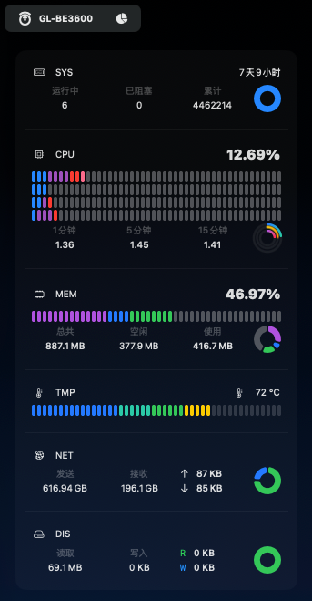
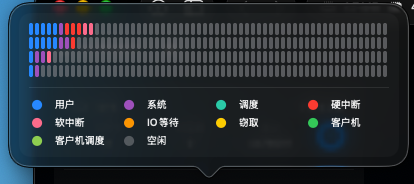

# ChartUI

[English](README.md) | [中文文档](README_CN.md)

A dedicated SwiftUI chart component library for the FoxTerm APP, providing dot segment bars, triple load rings, pie charts, and other visualization components.

> This library is a dedicated core component for the [FoxTerm](https://foxterm.app/) APP. Feel free to download and try it: [https://foxterm.app/](https://foxterm.app/)

## Components

| Component | Description |
|-----------|-------------|
| `DotSegmentBarView` | Dot segment bar chart, rendered with Canvas for pixel-perfect alignment, ideal for CPU/memory usage display |
| `TripleRingLoadChart` | Triple concentric gradient rings showing 1/5/15 minute load averages, with customizable colors and line widths |
| `PieChartProgressView` | Ring-style pie chart, built with Swift Charts `SectorMark` |
| `DotColorValue` | Generic data model (label + color + value) |

## Requirements

| Platform | Minimum Version |
|----------|----------------|
| iOS      | 17.0           |
| macOS    | 14.0           |
| Swift    | 5.10           |

## Installation

### Swift Package Manager

```swift
.package(url: "https://github.com/foxterm/ChartUI.git", .upToNextMinor(from: "1.0.0")),
```

```swift
.product(name: "ChartUI", package: "ChartUI"),
```

### CocoaPods

```ruby
pod 'ChartUI', :git => 'https://github.com/foxterm/ChartUI.git'
```

## Usage

### DotSegmentBarView — Dot Segment Bar

```swift
DotSegmentBarView(data: [
    DotColorValue(label: "User", color: .blue, value: 35),
    DotColorValue(label: "System", color: .orange, value: 15),
    DotColorValue(label: "Idle", color: .gray.opacity(0.3), value: 50),
])
```

### TripleRingLoadChart — Triple Load Ring

```swift
TripleRingLoadChart(
    load1: 2.5,
    load5: 1.8,
    load15: 1.2,
    physicalCores: 8
)
```

### PieChartProgressView — Ring Pie Chart

```swift
PieChartProgressView(data: [
    DotColorValue(label: "Used", color: .blue, value: 64),
    DotColorValue(label: "Free", color: .gray.opacity(0.3), value: 36),
])
```

## Demo





## License

MIT
